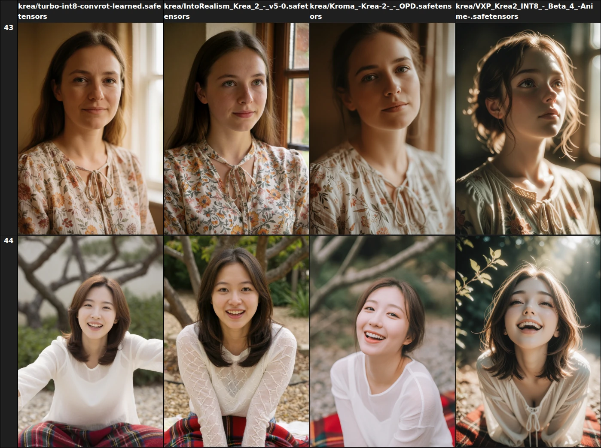
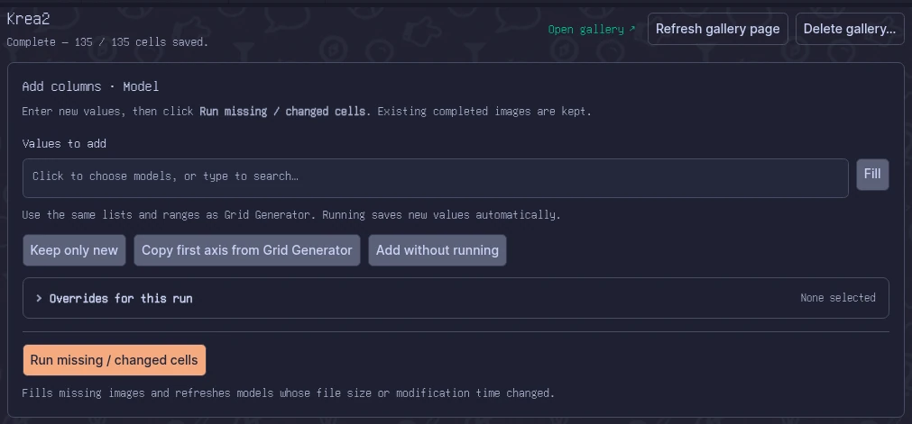
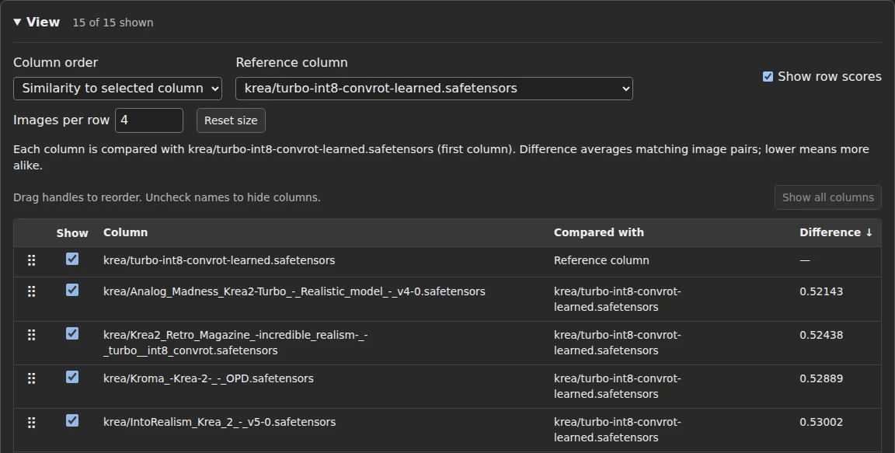
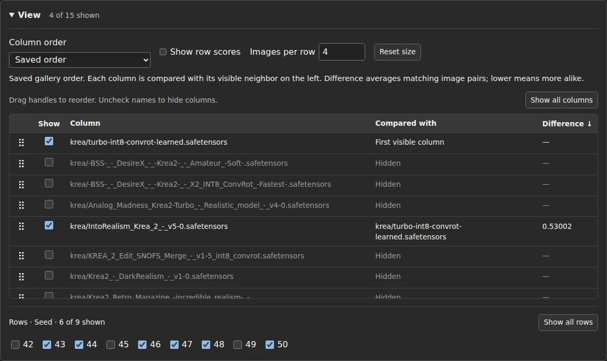
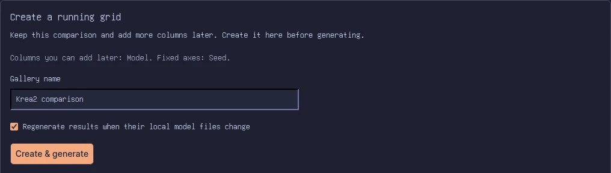

# Grid Tweaks

**Find similar results. Keep comparisons organized.**

Find results that look alike with visual similarity scores and sorting. Keep your saved comparisons in one place, and delete unwanted columns along with their images.

*Same seeds, different models.*

[Start your first comparison](#start-a-comparison)

## Choose what grows

For galleries created through Grid Tweaks, the **first axis** is the part of your comparison you can keep adding to. **All other axes keep their original values**, giving each new addition the same comparison points.

For example, put **Model first and Seed second**. When you find another model worth trying, add it to the gallery and compare it using the same seeds and saved settings as the earlier models.

- **Return to your saved setup.** Choose a named gallery to use its captured prompts, seeds, and settings.
- **Skip duplicates.** Paste a list of models or LoRAs and use **Keep only new** to remove repeats and values already in the gallery.
- **Try a temporary change.** Use **Overrides for this run** to apply selected settings without changing your saved setup or existing images.
- **Refresh changed models.** Regenerate affected results when a model file changes.

## Find the results that look alike

Comparing lots of models? Bring similar outputs together, or use a favorite column as your reference.

Select **Analyze similarity** in Grid Tweaks, then open or reload the gallery. Under **View**, choose:

- **Similarity chain** to place visually similar columns next to one another.
- **Similarity to selected column** to rank columns against your chosen **Reference column**.

Lower **Difference** scores mean the images look more alike; they do not measure quality. Turn on **Show row scores** to compare individual images. Enable **Update after each generation run** in Grid Tweaks to keep scores current as the gallery grows.

## Focus on what matters

Use the gallery's existing row and column hiding to narrow your comparison. Grid Tweaks adds controls to drag columns into your preferred order and adjust **Images per row** for a closer look or a wider overview. Your browser remembers these choices for each gallery.

Hiding keeps your images, so you can show them again later.

## Clear out old results

Finished comparing a model? In **Grid Tweaks**, select its column under **Column order** and choose **Remove selected**. This permanently removes that column and its generated images from the gallery. Your model files and other galleries stay untouched.

Done with the whole comparison? Choose **Delete gallery…** to remove the gallery and all its generated images. Your model files are kept.

## Start a comparison

1. Set your generation settings in SwarmUI. Open **Tools** and select **Grid Generator**.
2. Choose your axes and enter the values to compare. Put the setting you want to expand later on the **first axis**—for example, Model first and Seed second.
3. Under **Create a running grid**, enter a name and select **Create & generate**.
4. Select **Grid Tweaks** from the Tools dropdown to manage the saved comparison, then **Open gallery** to browse it.
5. To expand it later, enter **Values to add** and select **Run missing / changed cells**. You can also choose **Add without running** to prepare the next batch.

Want a different set of seeds, other axes, or saved settings? Start a new gallery for that comparison. Existing ordinary grids cannot be imported.

First-time similarity analysis downloads about 250 MB and requires **Install Features** permission.

After updating the extension, restart SwarmUI, select **Refresh gallery page**, and reload your gallery to get the latest controls.
